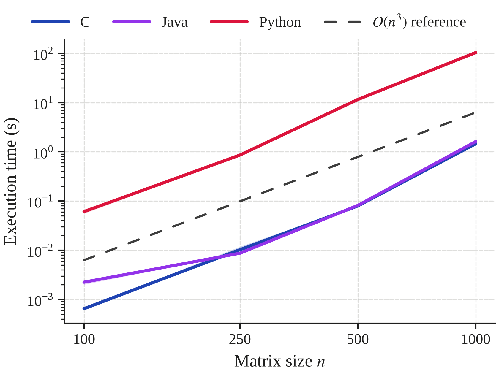
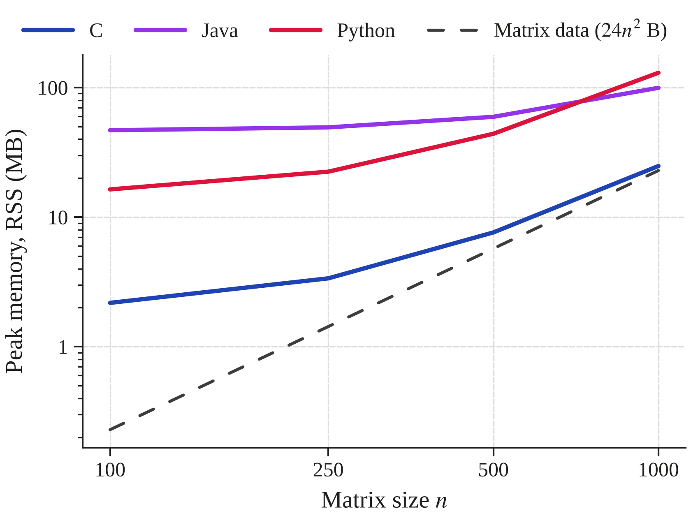

<div align="center">

# Basic Matrix Multiplication in Different Languages

**An $O(n^3)$ benchmarking study of C, Java and Python on identical inputs**


[Overview](#overview) •
[Prerequisites](#prerequisites--dependencies) •
[Quick Start](#quick-start) •
[Protocol](#experimental-protocol--parameters) •
[Environment](#reproducibility--test-environment) •
[Layout](#repository-layout)

</div>

---

## Overview

> **Research question:** how does the matrix size $n$ affect the execution time
> and memory usage of the textbook $O(n^3)$ dense matrix multiplication, and how
> do an ahead-of-time compiled language (C), a JIT-compiled language (Java) and
> an interpreted language (Python) compare on the same hardware?

This project implements the **same triple-loop algorithm** in three languages and
measures it under a common, fully automated protocol:

- **Fair by construction.** The same i-j-k loop order, 64-bit IEEE 754
  doubles, a flat row-major memory layout and **bit-identical input matrices**
  read from one shared binary file.
- **Validated first.** Before benchmarking, each language's result is checked
  against a correctly rounded reference (identity, zero, known 3×3 and random
  cases), with documented floating-point tolerances.
- **Measured carefully.** Only the kernel is timed, with a monotonic clock.
  Each repetition runs in a fresh process, Java gets untimed JIT warm-up runs,
  and peak memory is measured with GNU `time`.
- **Analysed by script.** Medians, interquartile ranges, fitted scaling
  exponents and publication-ready plots are generated straight from the raw
  data.

### Results at a glance

<p align="center">
  
  &nbsp;
  
</p>

| Median at $n = 1000$ | C | Java | Python |
|---|---:|---:|---:|
| Kernel time | 1.46 s | 1.61 s | 103.8 s |
| Peak memory (RSS) | 24.80 MB | 99.55 MB | 130.08 MB |
| Fitted time exponent (model: 3) | 3.30 | 2.84 | 3.27 |

Full statistics are in [`results/results_summary.md`](results/results_summary.md),
and the analysis is in the report ([`report/main.tex`](report/main.tex)). These
numbers describe one machine and configuration ([Test environment](#reproducibility--test-environment)).

---

## Prerequisites & Dependencies

A **Linux shell** is required: GNU `time` does not exist on native Windows, so use
WSL on Windows (see the notes under [Quick Start](#quick-start)).

| Tool | Minimum version | Used in this study | Purpose | Verify with |
|---|---|---|---|---|
| **Python** (CPython) | 3.10 | 3.14.4 | Python implementation, scripts, analysis | `python3 --version` |
| **GCC** | C11 support | 15.2.0 | Compiles the C implementation | `gcc --version` |
| **JDK** | 11 | OpenJDK 25.0.4.1 | Compiles and runs the Java implementation | `javac -version` and `java -version` |
| **GNU time** | any | system package | Measures peak memory (max RSS) | `/usr/bin/time --version` |
| **Git** | any | system package | Clones the repository | `git --version` |
| **pandas / Matplotlib** | 2.0 / 3.7 | 3.0.5 / 3.11.2 | Statistics and figures (`requirements.txt`) | `pip show pandas matplotlib` |
| *LaTeX (optional)* | TeX Live with `IEEEtran` | — | Builds the PDF report | `pdflatex --version` |

The benchmark itself (implementations, harness, correctness checks) uses **only the
Python standard library**; pandas and Matplotlib are needed only for the analysis step.

---

## Quick Start

All commands run from the **repository root**.

### 1. Set up the environment (Ubuntu / WSL)

```bash
git clone https://github.com/javierruanohdez/big-data-assignments.git
cd big-data-assignments

sudo apt update
sudo apt install build-essential default-jdk python3 python3-venv time fonts-liberation
rm -rf ~/.cache/matplotlib   # let Matplotlib find the newly installed serif font

python3 -m venv venv
source venv/bin/activate
pip install -r assignment_1/requirements.txt
```

### 2. Check correctness

```bash
python3 assignment_1/verify_correctness.py
```

This builds the C and Java programs, runs all three languages on the four test cases
and prints `PASS`/`FAIL` with the largest error. It ends with `All checks passed.`
(exit code 0).

### 3. Run the full benchmark pipeline

```bash
python3 assignment_1/run_benchmark.py
```

This builds the programs, generates any missing input files in `data/`, runs
**4 sizes × 3 languages × 5 repetitions** and writes one row per run to
`assignment_1/results/measurements.csv`. Total duration on the test machine:
roughly **11 minutes**. This is an estimate: the measured kernels alone add up to
10.3 minutes, most of it Python at $n = 1000$.

Optional arguments, e.g. for a quick test run:

```bash
python3 assignment_1/run_benchmark.py --sizes 100 250 --repetitions 5 --languages c java python --timeout 300
```

### 4. Generate statistics and figures

```bash
python3 assignment_1/plot_results.py            # figures for the paper (no titles)
python3 assignment_1/plot_results.py --titles   # same figures with titles, for slides
```

This reads `results/measurements.csv` and writes the figures (PDF + PNG) and
`results/results_summary.md` (see [Outputs](#outputs)).

### 5. Build the report (optional)

```bash
sudo apt install texlive-latex-recommended texlive-latex-extra texlive-fonts-recommended texlive-publishers latexmk
cd assignment_1/report && latexmk -pdf main.tex
```

<details>
<summary><b>Windows / WSL notes</b></summary>

<br>

- **Install WSL** from PowerShell with `wsl --install -d Ubuntu`, then run every
  command above inside the Ubuntu terminal.
- **Repository on the Windows drive:** it is reachable under `/mnt/c/...`, e.g.
  `cd "/mnt/c/Users/<user>/Desktop/.../big-data-assignments"`. Paths with spaces
  or accents need quotes. File access through `/mnt/c` is slower, but file loading
  is outside every timed region.
- **Memory:** by default WSL 2 can use about half of the host RAM. Change it
  with `memory=` in `%UserProfile%\.wslconfig` if needed.
- **Power:** keep the laptop plugged in and use the *Best performance* power mode
  while benchmarking.
- **Line endings:** edit configuration files (e.g. `.gitignore`) from WSL or an
  editor. PowerShell's `echo ... >> file` writes UTF-16 text, which Git
  cannot read.

</details>

<details>
<summary><b>Building and running each program manually</b></summary>

<br>

```bash
# Shared input file (A and B for n = 500)
python3 common/data_generator.py --sizes 500 --seed 42 --output-dir data

# C
mkdir -p assignment_1/build/c
gcc -O2 -std=c11 -Wall -Wextra -o assignment_1/build/c/matmul assignment_1/src/c/matmul.c
assignment_1/build/c/matmul data/matrices_n500.bin

# Java
javac -d assignment_1/build/java assignment_1/src/java/MatMul.java
java -Xmx2g -cp assignment_1/build/java MatMul data/matrices_n500.bin --warmup 3

# Python
python3 assignment_1/src/python/matmul.py data/matrices_n500.bin
```

Each program prints one line, e.g. `n=500 time_s=0.079447 checksum=...`.
Add `--output result.bin` to save the result matrix.

</details>

### Outputs

| File | Content |
|---|---|
| `results/measurements.csv` | Raw data (the required `results.csv`): `size, language, repetition, time_s, memory_mb, status`, one row per run |
| `results/results_summary.md` | Median and IQR of time and memory, empirical scaling exponents, excluded runs |
| `results/time_vs_size.pdf` / `.png` | Kernel time vs. $n$ (log-log) with an $O(n^3)$ reference line |
| `results/memory_vs_size.pdf` / `.png` | Peak RSS vs. $n$ (log-log) with the theoretical size of the three matrices |

Use the PDF figures in LaTeX at column width (`\includegraphics[width=\columnwidth]{...}`),
which gives the intended printed text sizes. The figure style is defined in
[`common/plotting_style.md`](../common/plotting_style.md).

---

## Experimental Protocol & Parameters

### Fixed experiment parameters

All values are defined once in [`benchmark_config.py`](benchmark_config.py).

| Parameter | Value | Justification |
|---|---|---|
| Matrix sizes $n$ | 100, 250, 500, 1000 | Roughly ×2 steps; 1000 is the largest size at which Python stays within the time budget |
| Measured repetitions | 5 per (size, language) | Minimum required; median and IQR are robust with 5 values |
| Time budget | 300 s per run | Hard limit; a run that exceeds it is recorded as `timeout` with no time |
| Input seed | 42 | Same matrices in every language and every run |
| Value range | uniform in $[-1, 1)$ | Keeps sums well scaled for floating-point comparisons |
| C flags | `gcc -O2 -std=c11 -Wall -Wextra` | `-O2` is the standard release level. `-O0` would measure an artificially slow program; `-O3` adds auto-vectorization, which this loop (strided access to B, sequential sum) cannot use without `-ffast-math` |
| JVM flags | `-Xmx2g` | Fixed maximum heap, so results do not depend on automatic heap sizing; far above what $n = 1000$ needs |
| Java warm-up | 3 untimed kernel runs before the timed run | Lets the JIT compile the kernel to native code; excluded from the measurement |
| Python | CPython, standard library only | No NumPy or other optimized library |

### Measurement method

- **Time:** each program measures **only the multiplication kernel**, with a
  monotonic clock (`clock_gettime(CLOCK_MONOTONIC)` in C, `System.nanoTime()` in
  Java, `time.perf_counter_ns()` in Python). Loading the input, allocating the
  result, process start-up and JVM start-up are outside the timed region.
- **Memory:** peak resident set size (max RSS) of the whole process, measured by
  GNU time (`/usr/bin/time -v`, field *Maximum resident set size*). The same
  metric is used for all three languages. For Java it includes the JVM itself
  (JIT compiler, class metadata, garbage collector), not only the matrices.
- **Repetitions:** every repetition is a fresh process, so each one starts from
  the same state and its peak RSS belongs to exactly one run.
- **Statistics:** median and interquartile range (IQR = Q3 − Q1, pandas linear
  interpolation) per (size, language). Runs with status `timeout` or `error`
  are excluded from the statistics and listed separately in the summary.

### Correctness checks

`verify_correctness.py` compares the result matrix of each language against an
independent, correctly rounded reference (`math.fsum`):

| Case | Expected result |
|---|---|
| Identity: $A \times I$ | exactly $A$ |
| Zero: $A \times 0$ | exactly $0$ |
| Known 3×3 product | hand-computed integer matrix |
| Random $n = 10$ (shared input) | `math.fsum` reference |

An element passes if `|x - ref| <= ABS_TOL + REL_TOL * |ref|`, with
`REL_TOL = 1e-12` and `ABS_TOL = 100 * n^2 * 2^-53` (1.1e-12 for $n = 10$),
derived from the standard dot-product rounding-error bound. On the test machine,
all 12 checks passed, with a largest error of 4.4e-16.

### Language-specific differences (unavoidable)

| Language | Matrix storage |
|---|---|
| C | one contiguous `double` block of $n^2$ elements |
| Java | one flat `double[]` (not `double[][]`, which stores each row as a separate object) |
| Python | one flat `list` of $n^2$ elements; a list stores pointers to boxed `float` objects (24 B each), not raw doubles |

---

## Reproducibility & Test Environment

> All results and conclusions apply **only** to this machine and configuration.

| Item | Value |
|---|---|
| CPU model | AMD Ryzen AI 5 330 (laptop) |
| Cores / logical threads | 4 (1× Zen 5 + 3× Zen 5c) / 8 |
| Clock | 2.0 GHz base; boost up to 4.5 GHz (Zen 5), 3.4 GHz (Zen 5c) |
| Caches | L1d 48 KB and L2 1 MB per core; L3 8 MB shared |
| RAM | 32 GB LPDDR5X-8000 (15 GB available to WSL 2) |
| Host OS | Windows 11 Home (build 26200) |
| Linux environment | WSL 2.7.14, Ubuntu 26.04 LTS | 
| Kernel | 6.18.33.2-microsoft-standard-WSL2 | 
| C compiler | GCC 15.2.0 |
| Java (vendor and version) | OpenJDK 25.0.4.1 (Ubuntu build) |
| Python (implementation and version) | CPython 3.14.4 |
| pandas / Matplotlib | 3.0.5 / 3.11.2 |


---

## Repository Layout

```
big-data-assignments/
├── README.md                    
├── common/
│   ├── data_generator.py        # shared input matrices (binary, fixed seed)
│   └── plotting_style.md        # project-wide figure style
├── data/                        # generated .bin inputs (git-ignored)
├── assignment_2/ … assignment_4/  # future assignments
└── assignment_1/
    ├── README.md                # this file
    ├── requirements.txt         # pandas, matplotlib (analysis only)
    ├── benchmark_config.py      # ALL fixed experiment parameters
    ├── verify_correctness.py    # correctness checks (run before benchmarking)
    ├── run_benchmark.py         # full benchmark pipeline -> results/measurements.csv
    ├── plot_results.py          # statistics, figures, results_summary.md
    ├── src/
    │   ├── c/matmul.c
    │   ├── java/MatMul.java
    │   └── python/matmul.py
    ├── results/                 # measurements, figures, summary (generated)
    ├── report/
    │   └── main.tex             # research report (IEEE two-column, LaTeX)
    └── build/                   # compiled programs (generated, git-ignored)
```

---

## Author

| | |
|---|---|
| **Name** | Javier Ruano Hernández |
| **GitHub** | [@javierruanohdez](https://github.com/javierruanohdez) |
| **Course** | Big Data (ULPGC) |

<div align="center">
<sub>Built with C, Java and Python · Measured, not guessed.</sub>
</div>
