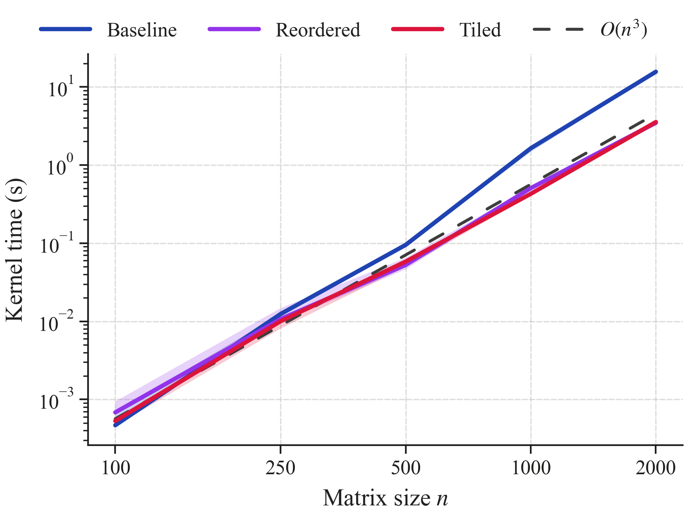
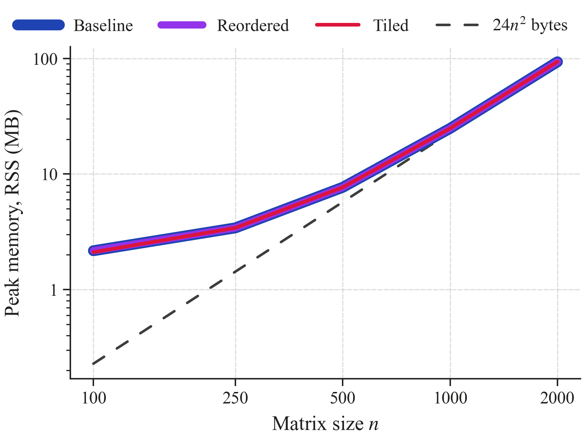
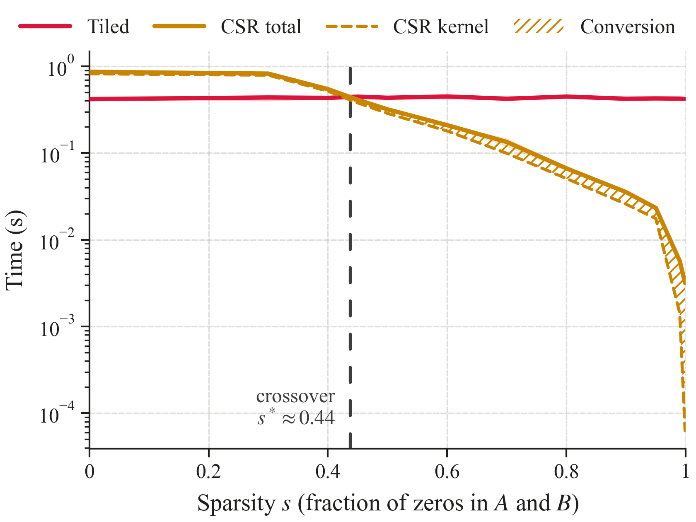
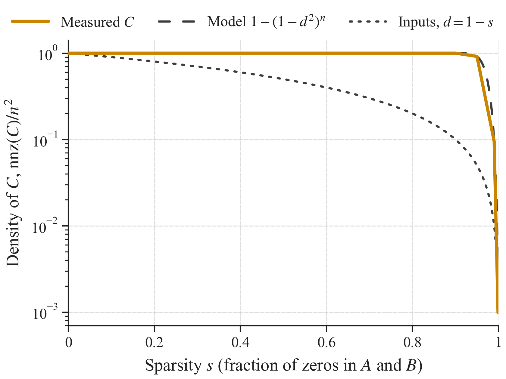

<div align="center">

# Optimised Matrix Multiplication and Sparse Matrices

**Cache-aware dense kernels and CSR sparse multiplication in C, measured on identical inputs**


[Overview](#overview) •
[Prerequisites](#prerequisites--dependencies) •
[Quick Start](#quick-start) •
[Protocol](#experimental-protocol--parameters) •
[Environment](#reproducibility--test-environment) •
[Layout](#repository-layout)

</div>

---

## Overview

> **Research questions.**
> **Part A (dense optimisation):** how much do loop reordering (i-k-j) and cache
> blocking (tiling) speed up the textbook $O(n^3)$ dense multiplication, and why?
> **Part B (sparse storage):** from which sparsity does a Compressed Sparse Row (CSR)
> multiplication beat the best dense kernel, once the conversion and indexing
> overheads are counted?

This project implements three dense kernels and one sparse kernel in C and measures
them under a common, fully automated protocol:

- **Two separate experiments.** Part A varies the matrix size $n$ on dense inputs;
  Part B fixes $n = 1000$ and varies the sparsity. The two parts are run, stored and
  analysed separately, so the effect of dense optimisations never mixes with the
  effect of sparse storage.
- **Fair by construction.** All four kernels are sequential C compiled with the same
  flags, use 64-bit IEEE 754 doubles and read the **same binary input files**. Sparse
  inputs are the dense matrices with entries removed, and all four kernels produce
  **bit-identical results**, so only the memory access pattern differs between them.
- **Validated first.** Every kernel is checked against a correctly rounded reference
  on dense and sparse cases, and the CSR kernel's non-zero counts are checked exactly.
- **Measured carefully.** Only kernels are timed, with a monotonic clock. The dense to
  CSR conversion is timed **separately** from the CSR multiplication. Each repetition
  runs in a fresh process, and peak memory is measured with GNU `time`.
- **Analysed by script.** Medians, interquartile ranges, speed-ups, scaling exponents,
  crossover points and publication-ready plots are generated straight from the raw data.

### Results at a glance

<p align="center">
  
  &nbsp;
  
</p>
<p align="center">
  
  &nbsp;
  
</p>

| Part A: median kernel time | Baseline (i-j-k) | Reordered (i-k-j) | Tiled ($b = 64$) |
|---|---:|---:|---:|
| $n = 1000$ | 1.64 s | 0.506 s (3.2×) | 0.428 s (3.8×) |
| $n = 2000$ | 15.6 s | 3.47 s (4.5×) | 3.55 s (4.4×) |
| Fitted time exponent (model: 3) | 3.48 | 2.84 | 2.90 |

| Part B: CSR vs. dense tiled, $n = 1000$ | Value |
|---|---:|
| Crossover sparsity, CSR total (multiply + conversion) | $s^* \approx 0.44$ |
| Crossover sparsity, CSR multiply alone | $s^* \approx 0.43$ |
| CSR speed-up at $s = 0.9$ / $0.99$ / $0.999$ | 11.9× / 74× / 132× |
| Conversion costs more than the CSR multiply from | $s \approx 0.97$ |
| Density of the result $C$ at $s = 0.95$ (fill-in) | 91.7 % |

Speed-ups in parentheses are relative to the baseline at the same size. Full statistics
are in [`results/results_summary.md`](results/results_summary.md). These numbers describe
one machine and configuration ([Test environment](#reproducibility--test-environment)):
the crossover in particular depends on the relative speed of the dense kernel, so it
moves from machine to machine.

---

## Prerequisites & Dependencies

A **Linux shell** is required: GNU `time` does not exist on native Windows, so use
WSL on Windows (see the notes under [Quick Start](#quick-start)).

| Tool | Minimum version | Purpose |
|---|---|---|
| **Python** (CPython) | 3.10 | Scripts and analysis |
| **GCC** | C11 support | Compiles the C kernels |
| **GNU time** | any | Measures peak memory (max RSS) |
| **Git** | any | Clones the repository |
| **pandas / Matplotlib** | 2.0 / 3.7 | Statistics and figures (`requirements.txt`) |
| *LaTeX (optional)* | TeX Live with `IEEEtran` | Builds the PDF report |

The benchmark itself (kernels, data generator, harness, correctness checks) uses **only
the Python standard library**; pandas and Matplotlib are needed only for the analysis step.

---

## Quick Start

All commands run from the **repository root**.

### 1. Set up the environment (Ubuntu / WSL)

```bash
git clone https://github.com/javierruanohdez/big-data-assignments.git
cd big-data-assignments

sudo apt update
sudo apt install build-essential python3 python3-venv time fonts-liberation
rm -rf ~/.cache/matplotlib   # let Matplotlib find the newly installed serif font

python3 -m venv venv
source venv/bin/activate
pip install -r assignment_2/requirements.txt
```

### 2. Check correctness

```bash
python3 assignment_2/verify_correctness.py
```

This builds both C programs, runs the four kernels on eight dense and sparse test cases
and prints `PASS`/`FAIL` with the largest error, the CSR non-zero counts and whether each
result is bit-identical to the baseline. It ends with `All checks passed.` (exit code 0).

### 3. Run the full benchmark pipeline

```bash
python3 assignment_2/run_benchmark.py
```

This builds the programs, generates any missing input files in `data/` (about 250 MB),
and runs both experiments, writing one row per run to
`assignment_2/results/measurements.csv`:

- **Part A:** 5 sizes × 3 dense kernels × 5 repetitions = 75 runs
- **Part B:** 12 sparsity levels × 2 kernels (tiled, CSR) × 5 repetitions = 120 runs

### 4. Generate statistics and figures

```bash
python3 assignment_2/plot_results.py            # figures for the paper (no titles)
python3 assignment_2/plot_results.py --titles   # same figures with titles, for slides
```

This reads `results/measurements.csv` and writes the four figures (PDF + PNG) and
`results/results_summary.md` (see [Outputs](#outputs)).

### 5. Build the report (optional)

```bash
sudo apt install texlive-latex-recommended texlive-latex-extra texlive-fonts-recommended texlive-publishers latexmk
cd assignment_2/report && latexmk -pdf main.tex
```

<details>
<summary><b>Windows / WSL notes</b></summary>

<br>

- **Install WSL** from PowerShell with `wsl --install -d Ubuntu`, then run every
  command above inside the Ubuntu terminal.
- **Repository on the Windows drive:** it is reachable under `/mnt/c/...`, e.g.
  `cd "/mnt/c/Users/<user>/Desktop/.../big-data-assignments"`. Paths with spaces
  or accents need quotes. File access through `/mnt/c` is slower, but file loading
  is outside every timed region.
- **Memory:** by default WSL 2 can use about half of the host RAM. Change it
  with `memory=` in `%UserProfile%\.wslconfig` if needed.
- **Power:** keep the laptop plugged in and use the *Best performance* power mode
  while benchmarking, and avoid other heavy work on the machine during the run.
- **Line endings:** edit configuration files (e.g. `.gitignore`) from WSL or an
  editor. PowerShell's `echo ... >> file` writes UTF-16 text, which Git
  cannot read.

</details>

<details>
<summary><b>Building and running each program manually</b></summary>

<br>

```bash
# Shared input files: dense n = 500, and n = 1000 with 90 % zeros
python3 common/data_generator.py --sizes 500 --seed 42 --output-dir data
python3 common/data_generator.py --sizes 1000 --sparsity 0.9 --seed 42 --output-dir data

# Build
mkdir -p assignment_2/build/c
gcc -O2 -std=c11 -Wall -Wextra -o assignment_2/build/c/dense_mult  assignment_2/src/c/dense_mult.c
gcc -O2 -std=c11 -Wall -Wextra -o assignment_2/build/c/sparse_mult assignment_2/src/c/sparse_mult.c

# Part A: the three dense kernels
assignment_2/build/c/dense_mult data/matrices_n500.bin --algo baseline
assignment_2/build/c/dense_mult data/matrices_n500.bin --algo reordered
assignment_2/build/c/dense_mult data/matrices_n500.bin --algo tiled --block-size 64

# Part B: dense tiled vs. CSR on the same sparse input
assignment_2/build/c/dense_mult  data/matrices_n1000_sp90.bin --algo tiled
assignment_2/build/c/sparse_mult data/matrices_n1000_sp90.bin
```

Each program prints one line of `key=value` pairs, e.g.

```
algo=tiled n=500 block_size=64 time_s=0.058110000 checksum=...
algo=csr n=1000 nnz_A=100000 nnz_B=100000 nnz_C=999948 csr_bytes=14423400 conversion_time_s=0.009702000 time_s=0.025760000 checksum=...
```

For the same input file, all four kernels print the same checksum. Add
`--output result.bin` to save the result matrix (both programs write the same dense format).

</details>

---

## Reproducibility & Test Environment

> All results and conclusions apply **only** to this machine and configuration.

| Item | Value |
| --- | --- |
| CPU model | AMD Ryzen AI 5 330 w/ Radeon 820M |
| Cores / logical threads | 4 cores / 8 threads |
| Caches | L1d: 192 KiB, L1i: 128 KiB, L2: 4 MiB, L3: 8 MiB |
| RAM | 15 GiB |
| Host OS | Ubuntu 26.04 LTS |
| Linux environment | WSL2 (Windows Subsystem for Linux) |
| Kernel | 6.18.33.2-microsoft-standard-WSL2 |
| C compiler | GCC 15.2.0 |
| Python (implementation and version) | CPython 3.14.4 |
| pandas / Matplotlib | pandas 3.0.3 / Matplotlib 3.10.9 |

---

## Repository Layout

```
big-data-assignments/
├── README.md
├── common/
│   ├── data_generator.py        # shared input matrices (binary, fixed seed, --sparsity)
│   └── plotting_style.md        # project-wide figure style
├── data/                        # generated .bin inputs (git-ignored)
├── assignment_1/                # basic matrix multiplication in C, Java and Python
└── assignment_2/
    ├── README.md                # this file
    ├── requirements.txt         # pandas, matplotlib, numpy (analysis only)
    ├── benchmark_config.py      # ALL fixed experiment parameters (Part A and Part B)
    ├── verify_correctness.py    # correctness checks (run before benchmarking)
    ├── run_benchmark.py         # full benchmark pipeline -> results/measurements.csv
    ├── plot_results.py          # statistics, figures, results_summary.md
    ├── src/
    │   └── c/
    │       ├── dense_mult.c     # Part A: baseline, reordered and tiled kernels
    │       └── sparse_mult.c    # Part B: dense -> CSR conversion and CSR x CSR kernel
    ├── results/                 # measurements, figures, summary (generated)
    ├── report/
    │   └── main.tex             # research report
    └── build/                   # compiled programs (generated, git-ignored)
```

---

## Author

| | |
|---|---|
| **Name** | Javier Ruano Hernández |
| **GitHub** | [@javierruanohdez](https://github.com/javierruanohdez) |
| **Course** | Big Data (ULPGC) |

<div align="center">
<sub>Built with C and Python · Measured, not guessed.</sub>
</div>
