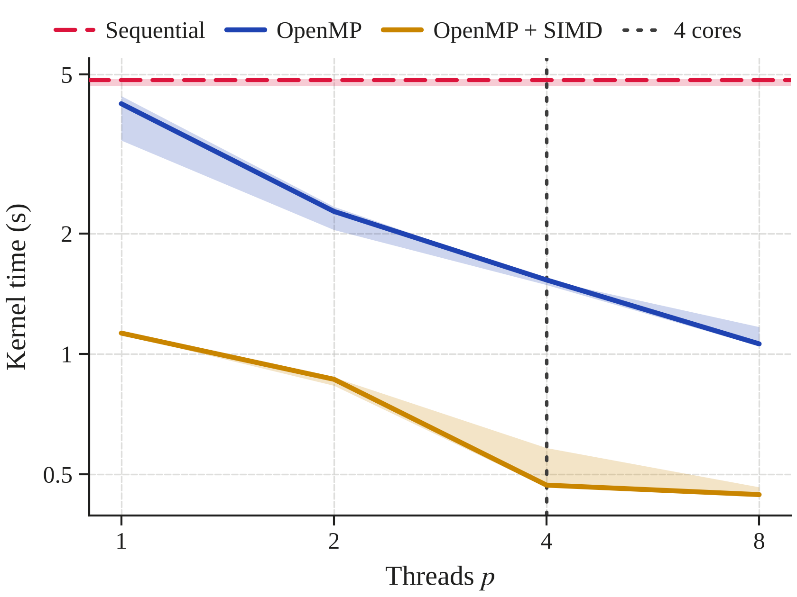
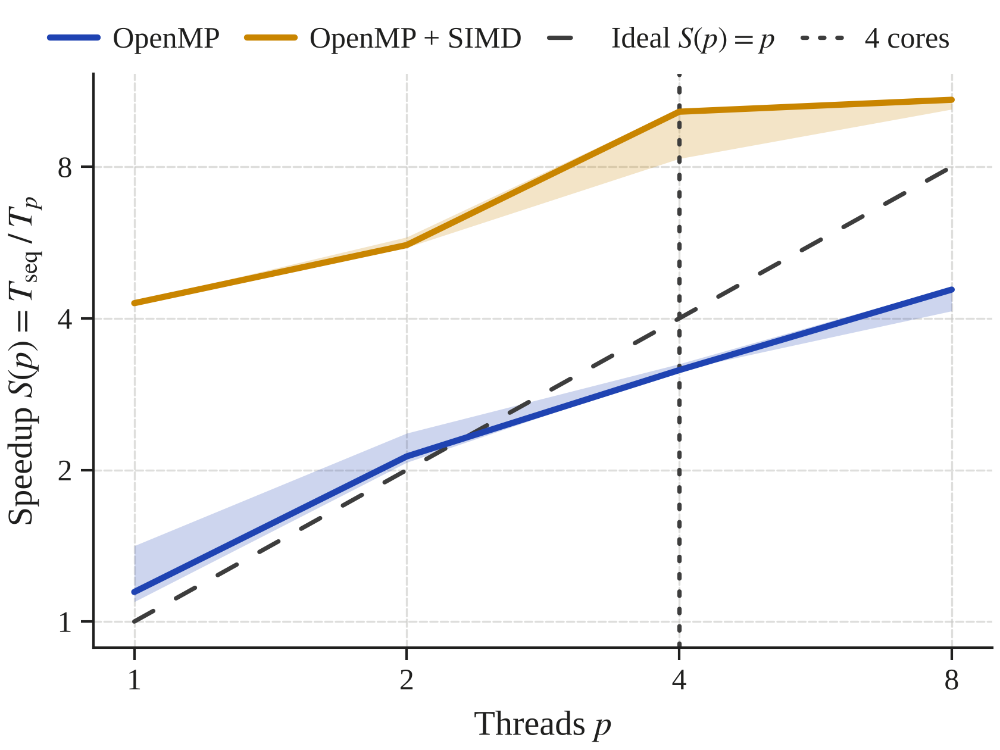
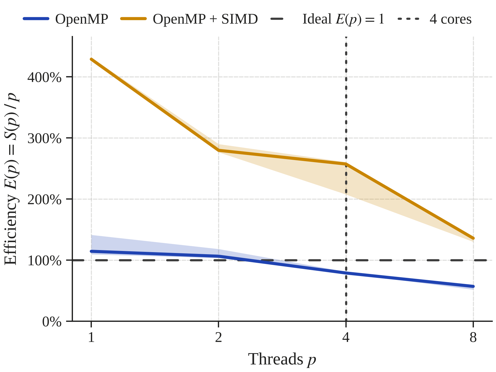

<div align="center">

# Parallel Matrix Multiplication and Vectorisation

**OpenMP multithreading and explicit SIMD on the tiled dense kernel, measured against the sequential baseline**


[Overview](#overview) •
[Prerequisites](#prerequisites--dependencies) •
[Quick Start](#quick-start) •
[Protocol](#experimental-protocol--parameters) •
[Environment](#reproducibility--test-environment) •
[Layout](#repository-layout)

</div>

---

## Overview

> **Research question.** How does the time of the cache-blocked (tiled) dense
> multiplication scale with the number of threads $p$, how far is it from the
> ideal linear speedup, and what does explicit SIMD vectorisation add on top of
> multithreading?

This project runs the tiled kernel of Assignment 2 in three ways and measures them
under a common, fully automated protocol:

- **Three kernels, one program.** `seq_tiled` is the sequential Assignment 2 kernel
  (the baseline), `omp_tiled` shares its row tiles among $p$ OpenMP threads, and
  `omp_simd_tiled` adds explicit SIMD (`#pragma omp simd`) to the innermost loop.
  All three live in one C file, are compiled with the same flags and read the
  **same binary input files**.
- **One change at a time.** `omp_tiled` differs from `seq_tiled` only by the OpenMP
  loop around the same scalar code; `omp_simd_tiled` differs from `omp_tiled` only by
  one directive on the inner loop. That vectorisation happened only where intended
  is **verified from the compiler's report**, not assumed.
- **Fair by construction.** Every result element is computed by one thread with its
  terms in the same order, and no FMA contraction is allowed, so all kernels and all
  thread counts produce **bit-identical results** (checked on every benchmark run).
- **Validated first.** Every kernel is checked against a correctly rounded reference
  with 1 to 16 threads and two block sizes, including uneven splits and idle threads.
- **Measured carefully.** Only the kernel is timed, with a monotonic wall clock. The
  thread team is started and the output matrix touched **before** the timer starts,
  threads are pinned to cores, each repetition runs in a fresh process, and peak
  memory is measured with GNU `time`.
- **Analysed by script.** Medians, interquartile ranges, speedup, efficiency, SIMD
  gain and publication-ready plots are generated straight from the raw data.

### Results at a glance

<p align="center">
  
  &nbsp;
  
</p>
<p align="center">
  
</p>

| Median kernel time, $n = 2000$ | $p = 1$ | $p = 2$ | $p = 4$ | $p = 8$ |
|---|---:|---:|---:|---:|
| `seq_tiled` (sequential) | 4.84 s | - | - | - |
| `omp_tiled` | 4.23 s | 2.27 s | 1.53 s | 1.06 s |
| `omp_simd_tiled` | 1.13 s | 0.865 s | 0.470 s | 0.445 s |

| At $p = 8$ | $n = 500$ | $n = 1000$ | $n = 2000$ |
|---|---:|---:|---:|
| `omp_tiled`: speedup $S(8)$ (efficiency $E(8)$) | 2.81 (35 %) | 3.88 (48 %) | 4.56 (57 %) |
| `omp_simd_tiled`: speedup $S(8)$ (efficiency $E(8)$) | 5.78 (72 %) | 8.64 (108 %) | 10.87 (136 %) |
| SIMD gain, $T_{\mathrm{omp}} / T_{\mathrm{simd}}$ | 2.05× | 2.23× | 2.38× |

Speedup and efficiency are relative to `seq_tiled` at the same size (see [Metrics](#metrics)).
Because `seq_tiled` is scalar, the `omp_simd_tiled` values also contain the SIMD gain,
which is why they can exceed the ideal ($S(p) > p$, $E(p) > 100\,\%$). The self-relative
speedup in the summary isolates the threading part: at $n = 2000$, $p = 8$ it is 3.99×
for `omp_tiled` and 2.53× for `omp_simd_tiled`. With one thread, `omp_tiled` was faster
than `seq_tiled` at every size (−12.6 % at $n = 2000$), although both run the same scalar
loops. Full statistics are in [`results/results_summary.md`](results/results_summary.md).
These numbers describe one machine and configuration
([Test environment](#reproducibility--test-environment)).

---

## Prerequisites & Dependencies

A **Linux shell** is required: GNU `time` does not exist on native Windows, so use
WSL on Windows (see the notes under [Quick Start](#quick-start)).

| Tool | Minimum version | Purpose |
|---|---|---|
| **Python** (CPython) | 3.10 | Scripts and analysis |
| **GCC** | 14 | Compiles the kernels; OpenMP runtime (libgomp). GCC 14 is the first version with `#pragma GCC novector` |
| **GNU time** | any | Measures peak memory (max RSS) |
| **Git** | any | Clones the repository |
| **pandas / Matplotlib** | 2.0 / 3.7 | Statistics and figures (`requirements.txt`) |

The benchmark itself (kernels, data generator, harness, correctness checks) uses **only
the Python standard library**; pandas and Matplotlib are needed only for the analysis step.
With an older GCC the program **refuses to compile** (an older compiler would silently
ignore `#pragma GCC novector` and vectorise the scalar reference kernels).

---

## Quick Start

All commands run from the **repository root**.

### 1. Set up the environment (Ubuntu / WSL)

```bash
git clone https://github.com/javierruanohdez/big-data-assignments.git
cd big-data-assignments

sudo apt update
sudo apt install build-essential python3 python3-venv time fonts-liberation
rm -rf ~/.cache/matplotlib   # let Matplotlib find the newly installed serif font
gcc --version                # must report 14 or newer (see the note below)

python3 -m venv venv
source venv/bin/activate
pip install -r assignment_3/requirements.txt
```

If `gcc` is older than 14 (e.g. Ubuntu 24.04 ships GCC 13), install `gcc-14` with
`sudo apt install gcc-14` and set `C_COMPILER = "gcc-14"` in
[`benchmark_config.py`](benchmark_config.py). OpenMP needs no extra package: `-fopenmp`
uses the libgomp runtime that comes with GCC.

### 2. Check correctness

```bash
python3 assignment_3/verify_correctness.py
```

This builds the program (which also writes the compiler's vectorisation report), checks
that report, and runs the three kernels on six test cases with block sizes 64 and 7 and,
for the OpenMP kernels, 1, 2, 3, 4, 8 and 16 threads. It prints `PASS`/`FAIL` with the
largest error and whether each result is bit-identical to `seq_tiled`, and ends with
`All checks passed.` (exit code 0). The first lines are the vectorisation proof:

```
Vectorisation report (results/vectorization_report.txt):
  seq_tiled       PASS  scalar      no vectorised loop
  omp_tiled       PASS  scalar      no vectorised loop
  omp_simd_tiled  PASS  vectorised  line 466: 64-byte vectors = 8 doubles (epilogue: 32-byte)
```

### 3. Run the full benchmark pipeline

```bash
python3 assignment_3/run_benchmark.py
```

This builds the program, generates any missing input files in `data/` (about 84 MB),
and sweeps sizes × kernels × thread counts, writing one row per run to
`assignment_3/results/measurements.csv`. On a machine with 8 logical CPUs:

- 3 sizes × (1 `seq_tiled` + 2 OpenMP kernels × 4 thread counts) × 5 repetitions = **135 runs**
- $p = 16$ exceeds the logical CPUs and is skipped (`--allow-oversubscription` runs it anyway)

### 4. Generate statistics and figures

```bash
python3 assignment_3/plot_results.py --physical-cores 4            # figures for the paper (no titles)
python3 assignment_3/plot_results.py --physical-cores 4 --titles   # same figures with titles, for slides
```

This reads `results/measurements.csv` and writes the three figures for $n = 2000$
(PDF + PNG) and `results/results_summary.md` (see [Outputs](#outputs)).
`--physical-cores` draws a dotted line at $p$ = number of physical cores (take the value
from the [test environment](#reproducibility--test-environment); omit the option to leave
the line out). `--size` selects another matrix size for the figures.

<details>
<summary><b>Windows / WSL notes</b></summary>

<br>

- **Install WSL** from PowerShell with `wsl --install -d Ubuntu`, then run every
  command above inside the Ubuntu terminal.
- **Repository on the Windows drive:** it is reachable under `/mnt/c/...`, e.g.
  `cd "/mnt/c/Users/<user>/Desktop/.../big-data-assignments"`. Paths with spaces
  or accents need quotes. File access through `/mnt/c` is slower, but file loading
  is outside every timed region.
- **CPUs visible to WSL:** WSL 2 sees all logical processors by default; `processors=`
  in `%UserProfile%\.wslconfig` lowers that number. `nproc` inside WSL must match the
  *Logical CPUs* row of the test environment, because `run_benchmark.py` skips every
  thread count above it.
- **Thread pinning:** `OMP_PLACES`/`OMP_PROC_BIND` pin threads to WSL's virtual CPUs.
  This stops migrations inside Linux; Windows still decides where those virtual CPUs run.
- **Memory:** by default WSL 2 can use about half of the host RAM. Change it
  with `memory=` in `%UserProfile%\.wslconfig` if needed.
- **Power:** keep the laptop plugged in and use the *Best performance* power mode
  while benchmarking, and avoid other heavy work on the machine during the run.
  All cores are busy at $p = 8$, so background load affects these runs more than
  the sequential ones.
- **Line endings:** edit configuration files (e.g. `.gitignore`) from WSL or an
  editor. PowerShell's `echo ... >> file` writes UTF-16 text, which Git
  cannot read.

</details>

<details>
<summary><b>Building and running the program manually</b></summary>

<br>

```bash
# Shared input file (dense, n = 2000)
python3 common/data_generator.py --sizes 2000 --seed 42 --output-dir data

# Build (from assignment_3/, so the report shows short paths).
# GCC appends to an existing report, so delete it first.
cd assignment_3
mkdir -p build/c results
rm -f results/vectorization_report.txt
gcc -O3 -march=native -ftree-vectorize -fopenmp -std=c11 -Wall -Wextra \
    -fopt-info-vec-optimized=results/vectorization_report.txt \
    -o build/c/parallel_mult src/c/parallel_mult.c
cd ..

# Thread pinning, as in benchmark_config.py
export OMP_PLACES=cores OMP_PROC_BIND=spread

# The three kernels (--threads is required for the OpenMP kernels)
assignment_3/build/c/parallel_mult data/matrices_n2000.bin --algo seq_tiled
assignment_3/build/c/parallel_mult data/matrices_n2000.bin --algo omp_tiled --threads 4
assignment_3/build/c/parallel_mult data/matrices_n2000.bin --algo omp_simd_tiled --threads 4 --block-size 64
```

The program prints one line of `key=value` pairs, e.g.

```
algo=omp_simd_tiled n=2000 threads=4 block_size=64 time_s=0.470073617 checksum=...
```

`threads` is the team size OpenMP really started (the program stops with an error if it
differs from `--threads`). For the same input file, all kernels and thread counts print
the same checksum. Add `--output result.bin` to save the result matrix.

</details>

### Outputs

| File | Content |
|---|---|
| `results/measurements.csv` | Raw data: `size, algo, threads, repetition, time_s, memory_mb, status`, one row per run |
| `results/vectorization_report.txt` | GCC's vectorisation report (`-fopt-info-vec-optimized`), rewritten at every build |
| `results/results_summary.md` | Median and IQR of time and memory, $S(p)$, $E(p)$, self-relative speedup, OpenMP at $p = 1$ vs. `seq_tiled`, SIMD gain, excluded runs |
| `results/time_vs_threads.pdf` / `.png` | Kernel time vs. $p$ for both OpenMP kernels, with `seq_tiled` as a horizontal reference |
| `results/speedup_vs_threads.pdf` / `.png` | $S(p)$ vs. $p$, with the ideal linear speedup $S(p) = p$ |
| `results/efficiency_vs_threads.pdf` / `.png` | $E(p)$ vs. $p$, with the ideal $E(p) = 1$ (100 %) |

Use the PDF figures in LaTeX at column width (`\includegraphics[width=\columnwidth]{...}`),
which gives the intended printed text sizes. The figure style is defined in
[`common/plotting_style.md`](../common/plotting_style.md).

---

## Experimental Protocol & Parameters

### Fixed experiment parameters

All values are defined once in [`benchmark_config.py`](benchmark_config.py).

| Parameter | Value | Justification |
|---|---|---|
| Matrix sizes $n$ | 500, 1000, 2000 | 500: the three matrices (6 MB) fit in the L3 cache, so start-up and synchronisation costs are most visible. 1000 and 2000 (24 MB, 96 MB) far exceed it: the regime where tiling matters and threads compete for memory bandwidth |
| Thread counts $p$ | 1, 2, 4, 8 (16 configured) | Doubling steps. $p = 1$ measures the OpenMP machinery against `seq_tiled`. Counts above the logical CPUs are skipped by default |
| Kernels | `seq_tiled` ($p = 1$ only), `omp_tiled`, `omp_simd_tiled` | Sequential baseline, threads only, threads + SIMD |
| Block size | 64 | One $64 \times 64$ tile = 32 KiB (about one L1d), three tiles fit in L2; a multiple of 8, which rules out false sharing (see below) |
| Measured repetitions | 5 per configuration | Minimum required; median and IQR are robust with 5 values |
| Time budget | 300 s per run | Hard limit; a run that exceeds it is recorded as `timeout` with no time |
| Input seed | 42 | Same matrices as in Assignments 1 and 2 |
| C flags | `gcc -O3 -march=native -ftree-vectorize -fopenmp -std=c11 -Wall -Wextra` | `-O3 -march=native`: full optimisation with every SIMD extension of this CPU. `-fopenmp`: OpenMP pragmas and runtime. `-std=c11` implies `-ffp-contract=off` (no FMA), which keeps all results bit-identical. Same flags for all three kernels |
| Vectorisation report | `-fopt-info-vec-optimized=results/vectorization_report.txt` | Lists every loop GCC vectorised (the same as `-fopt-info-vec`, written to a file) |
| OpenMP environment | `OMP_PLACES=cores`, `OMP_PROC_BIND=spread` | Pins threads; one thread per physical core up to $p$ = cores |

### OpenMP setup

- **Work split.** `omp_tiled` puts
  `#pragma omp parallel for schedule(static) default(none) shared(a, b, c, n, block_size)`
  on the **outermost tile loop**. Each iteration computes one whole block-row of $C$
  (rows `ii` to `ii + 63`, all columns, all `kk`), so no two threads ever write the same
  element: no data race, no locks, atomics or reductions, and every element still
  receives its terms in the order $k = 0, \dots, n-1$. Parallelising the `kk` loop
  instead would make threads add into the same $C$ tile at the same time.
- **Scheduling.** `schedule(static)` gives each thread one contiguous chunk of row
  tiles, fixed before the loop starts. All full tiles cost the same, so the even split
  is already balanced and costs nothing at run time. `default(none)` forces every
  shared variable to be listed, so none can be shared by accident.
- **No false sharing.** Threads write only $C$, in contiguous blocks of rows, and there
  are no shared counters or accumulators. $C$ is allocated 64-byte aligned, and with a
  block size that is a multiple of 8, every boundary between two threads' rows falls on
  a cache-line boundary: no 64-byte line is ever written by two threads.
- **Thread count.** The program calls `omp_set_dynamic(0)` and
  `omp_set_num_threads(p)` from `--threads`, which overrides `OMP_NUM_THREADS`. It checks
  the team size OpenMP actually started before timing and prints it; a mismatch stops the
  run, and `run_benchmark.py` records any run that reports a different count as `error`.
- **Start-up outside the timer.** OpenMP creates its threads at the first parallel
  region. That region is the untimed NaN pre-fill of $C$, run with the same $p$, which
  also maps every page of $C$. The timed kernel therefore reuses a running team, and
  $p = 1$ vs. `seq_tiled` measures the per-call cost of OpenMP, not thread creation.
- **Pinning and SMT.** With `OMP_PLACES=cores` and `OMP_PROC_BIND=spread`, threads are
  spread over the physical cores: up to $p$ = cores, every thread has a core of its own;
  beyond that, two threads share one core (SMT). See
  [Reading thread counts against the hardware](#reading-thread-counts-against-the-hardware).

### Vectorisation: how it is forced and verified

At `-O3`, GCC auto-vectorises the i-k-j inner loop (`c_row[j] += a_ik * b_row[j]`) in
**every** kernel. Left alone, `omp_tiled` vs. `omp_simd_tiled` would compare vector code
with vector code. So each kernel states what it wants for its innermost loop:

| Kernel | Inner-loop directive | Result |
|---|---|---|
| `seq_tiled` | `#pragma GCC novector` | Scalar: one double per instruction |
| `omp_tiled` | `#pragma GCC novector` | Scalar: one double per instruction |
| `omp_simd_tiled` | `#pragma omp simd` | Vector: 4 doubles (AVX2) or 8 doubles (AVX-512) per instruction, without a run-time aliasing check |

`#pragma omp simd` is a promise that the iterations are independent, which holds here
(B and C are separate arrays, iteration $j$ touches only `c_row[j]`), so GCC emits the
vector loop directly instead of guarding it with an overlap test. SIMD lanes hold
neighbouring columns, so each element's summation order does not change, and without FMA
the results stay bit-identical to the scalar kernels.

**Verification from the compiler log.** Every build writes
[`results/vectorization_report.txt`](results/vectorization_report.txt). The entries for
the timed kernels are:

```
src/c/parallel_mult.c:466:34: optimized: loop vectorized using 64 byte vectors
src/c/parallel_mult.c:466:34: optimized: loop vectorized using 32 byte vectors
```

Line 466 is the inner loop of `multiply_omp_simd_tiled()`. 64-byte vectors are AVX-512
registers (8 doubles); the 32-byte entry is the vectorised epilogue for the last few
iterations. No entry points into `multiply_seq_tiled()` or `multiply_omp_tiled()`. The
other entries are outside the timed region: the NaN pre-fill (line 516), the checksum
(line 554, an in-order reduction that keeps the summation order), and "basic block part
vectorized" at the `#pragma omp parallel` lines (GCC packing the shared variables for the
threads, once per call). `verify_correctness.py` maps every "loop vectorized" entry to its
function and fails if a scalar kernel has one or the SIMD kernel has none.

### Metrics

$$S(p) = \frac{T_{\mathrm{seq}}(n)}{T_p(n)}, \qquad E(p) = \frac{S(p)}{p}$$

- $T_{\mathrm{seq}}(n)$ is the median time of `seq_tiled` at size $n$, and $T_p(n)$ the
  median time of the kernel with $p$ threads at the same $n$. Ideal scaling is
  $S(p) = p$, i.e. $E(p) = 1$ (100 %).
- `seq_tiled` is scalar, so for `omp_simd_tiled`, $S(p)$ contains both the threading gain
  and the SIMD gain and can exceed $p$. Two further metrics in the summary separate them:
  the **self-relative speedup** $T(1)/T(p)$ of each kernel against itself on one thread,
  and the **SIMD gain** $T_{\mathrm{omp}}(p) / T_{\mathrm{simd}}(p)$ at equal $p$.
- Shaded bands in the speedup and efficiency figures run from
  $T_{\mathrm{seq}} / Q_3(T_p)$ to $T_{\mathrm{seq}} / Q_1(T_p)$ (and the same divided by
  $p$): the spread of the parallel runs, with $T_{\mathrm{seq}}$ at its median.

### Measurement method

- **Time:** the program measures **only the multiplication kernel** with
  `clock_gettime(CLOCK_MONOTONIC)`, printed with nanosecond resolution (`%.9f`). This is
  wall-clock time, as a speedup requires (CPU-time clocks add up all threads). Loading
  the input, allocating and pre-filling the output, starting the threads and process
  start-up are outside the timed region.
- **Memory:** peak resident set size (max RSS) of the whole process, measured by GNU
  time (`/usr/bin/time -v`, field *Maximum resident set size*). It is dominated by the
  three matrices; each extra thread adds only the stack pages it touches.
- **Repetitions:** every repetition is a fresh process, so each one starts from the
  same state and its peak RSS belongs to exactly one run.
- **Statistics:** median and interquartile range (IQR = Q3 − Q1, pandas linear
  interpolation) per (size, kernel, threads). Runs with status `timeout`, `error` or
  `mismatch` are excluded from the statistics and listed separately in the summary.
- **Consistency:** all kernels and thread counts must print the same checksum for the
  same input file; a run with a different one is recorded as `mismatch`.

### Correctness checks

`verify_correctness.py` compares every result against an independent, correctly rounded
reference (`math.fsum`):

| Case | Expected result | What it exercises |
|---|---|---|
| Identity: $A \times I$ | exactly $A$ | |
| Zero: $A \times 0$ | exactly $0$ | |
| Known 3×3 product | hand-computed integer matrix | Fewer row tiles than threads |
| Random $n = 10$ (shared input) | `math.fsum` reference | |
| Random $n = 100$ | `math.fsum` reference | Full and partial edge tiles |
| Random $n = 131$ | `math.fsum` reference | Odd prime size: every tile edge is uneven |

Each case runs with block sizes 64 (the benchmark value) and 7 (many tiles per thread;
inner loops shorter than and not a multiple of the SIMD width, so the vector epilogue
runs), and with 1, 2, 3, 4, 8 and 16 threads (3: uneven split; 16: idle threads for
small $n$). An element passes if `|x - ref| <= ABS_TOL + REL_TOL * |ref|`, with
`REL_TOL = 1e-12` and `ABS_TOL = 100 * n^2 * 2^-53`, the same rule as in Assignments 1
and 2. The script also checks that the program reports the requested thread count and
block size.

---

## Reproducibility & Test Environment

> All results and conclusions apply **only** to this machine and configuration.

| Item | Value | How to obtain (inside WSL unless noted) |
|---|---|---|
| CPU model | [TODO] | `lscpu` → *Model name* |
| Physical cores | [TODO] | `lscpu` → *Core(s) per socket* × *Socket(s)* |
| Logical CPUs (hardware threads) | [TODO] | `nproc` |
| Threads per core (SMT) | [TODO] | `lscpu` → *Thread(s) per core* |
| Clock (base / boost) | [TODO] | Manufacturer data sheet |
| Caches | [TODO] | `lscpu` → *L1d*, *L2*, *L3* |
| SIMD extensions | [TODO] | `lscpu` → *Flags* (`avx2`, `avx512f`); the vector width used is in `results/vectorization_report.txt` |
| RAM | [TODO] | `free -h` (and total host RAM) |
| Host OS | [TODO] | `winver` (Windows) |
| Linux environment | [TODO] | `wsl --version` (PowerShell), `lsb_release -d` |
| Kernel | [TODO] | `uname -r` |
| C compiler | [TODO] | `gcc --version` |
| OpenMP version (libgomp) | [TODO] | `echo \| gcc -fopenmp -dM -E - \| grep _OPENMP` (e.g. `201511` = OpenMP 4.5) |
| Power mode | [TODO] | Windows power settings |
| Python (implementation and version) | [TODO] | `python3 --version` |
| pandas / Matplotlib | [TODO] | `pip show pandas matplotlib` |

### Reading thread counts against the hardware

| Thread count | What each thread gets |
|---|---|
| $p \le$ physical cores | A whole core of its own (with `OMP_PROC_BIND=spread`) |
| physical cores $< p \le$ logical CPUs | SMT: two threads share one core's execution units and caches, so less gain per added thread is expected |
| $p >$ logical CPUs | **Oversubscription**: the OS time-slices threads on the same hardware thread. Skipped by `run_benchmark.py` unless `--allow-oversubscription` is given |

---

## Repository Layout

```
big-data-assignments/
├── README.md
├── common/
│   ├── data_generator.py        # shared input matrices (binary, fixed seed)
│   └── plotting_style.md        # project-wide figure style
├── data/                        # generated .bin inputs (git-ignored)
├── assignment_1/                # basic matrix multiplication in C, Java and Python
├── assignment_2/                # cache-aware dense kernels and CSR sparse multiplication
└── assignment_3/
    ├── README.md                # this file
    ├── requirements.txt         # pandas, matplotlib (analysis only)
    ├── benchmark_config.py      # ALL fixed experiment parameters, build flags, OpenMP settings
    ├── verify_correctness.py    # correctness + vectorisation-report checks (run before benchmarking)
    ├── run_benchmark.py         # size x kernel x thread sweep -> results/measurements.csv
    ├── plot_results.py          # statistics, figures, results_summary.md
    ├── src/
    │   └── c/
    │       └── parallel_mult.c  # seq_tiled, omp_tiled and omp_simd_tiled kernels
    ├── results/                 # measurements, vectorisation report, figures, summary
    └── build/                   # compiled program and test files (generated, git-ignored)
```

---

## Author

| | |
|---|---|
| **Name** | Javier Ruano Hernández |
| **GitHub** | [@javierruanohdez](https://github.com/javierruanohdez) |
| **Course** | Big Data (ULPGC) |

<div align="center">
<sub>Built with C, OpenMP and Python · Measured, not guessed.</sub>
</div>
