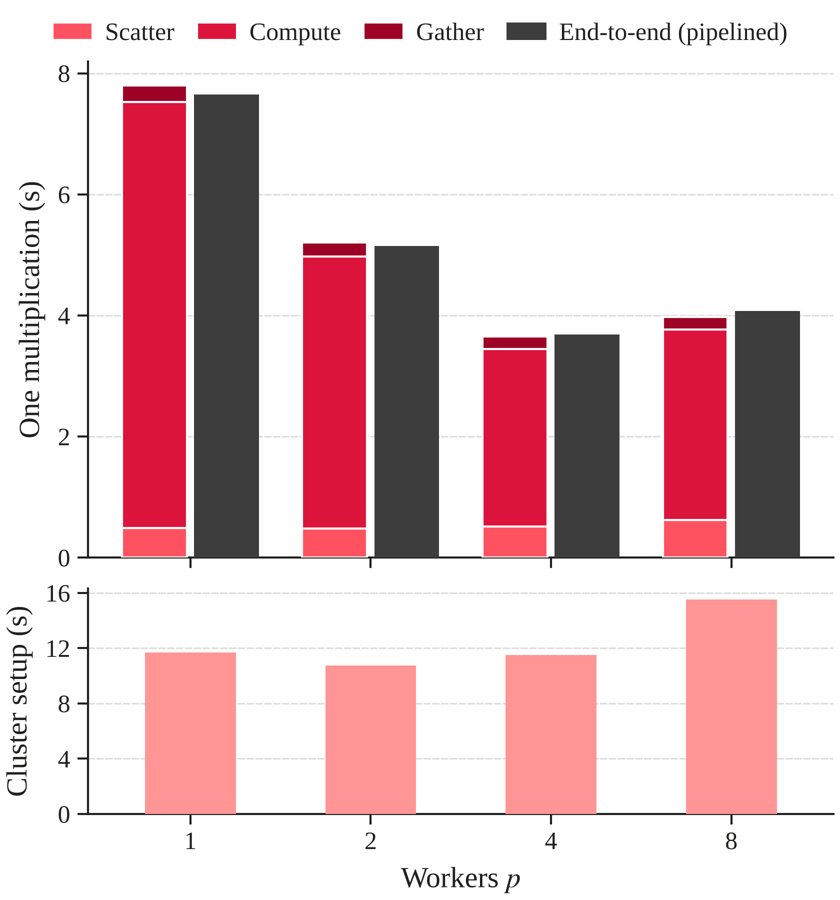
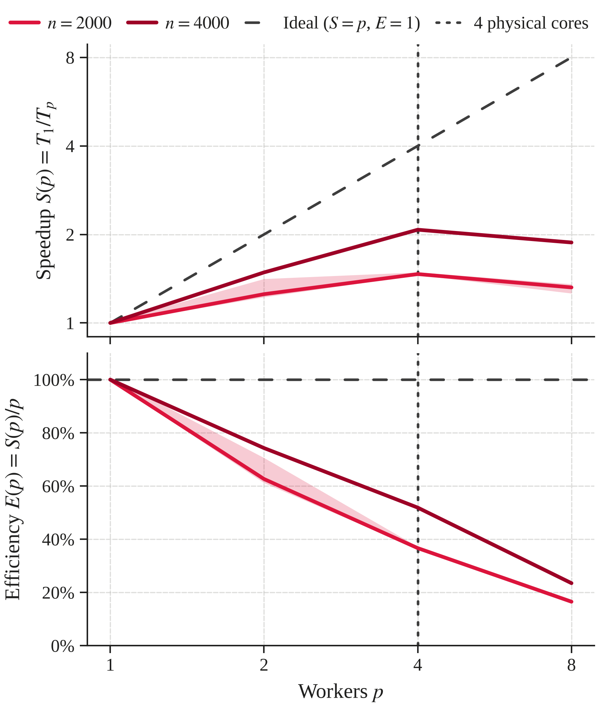
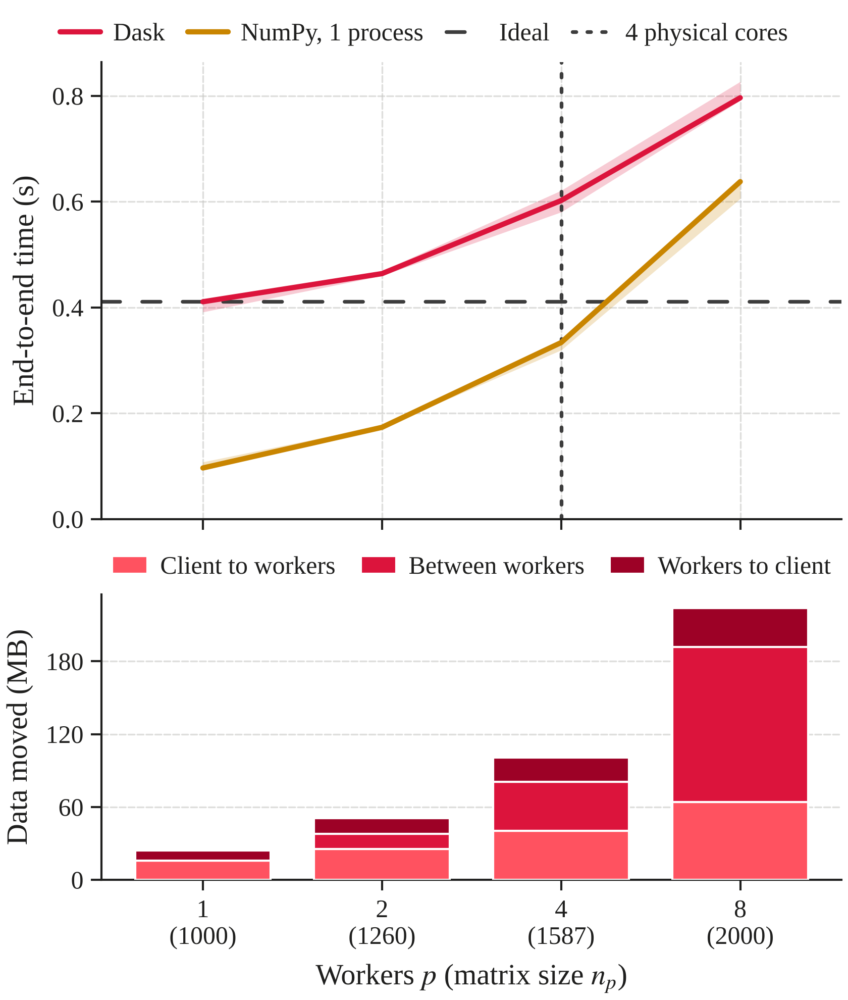
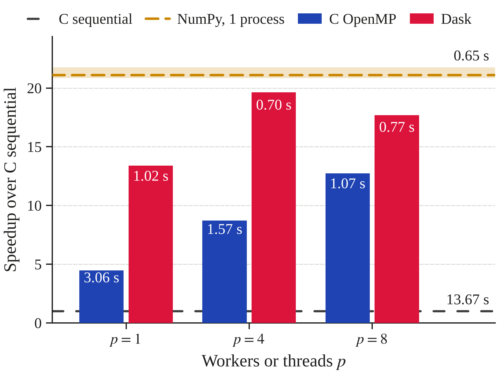

<div align="center">

# Distributed Matrix Multiplication

**2D block-partitioned multiplication on a multi-process Dask cluster, measured against sequential and shared-memory parallel C on the same inputs**


[Overview](#overview) •
[Execution model](#execution-model-local-multi-process) •
[Prerequisites](#prerequisites--dependencies) •
[Quick Start](#quick-start) •
[Protocol](#experimental-protocol--parameters) •
[Environment](#reproducibility--test-environment) •
[Layout](#repository-layout)

</div>

---

## Overview

> **Research question.** How does a distributed (multi-process, message-passing) block
> matrix multiplication scale with the number of worker processes $p$, what do
> partitioning, data transfer and scheduling cost, and how does it compare with the
> sequential (Assignment 2) and shared-memory parallel (Assignment 3) C programs on the
> same input files?

The program cuts $A$, $B$ and $C$ into $b \times b$ tiles, places them on a Dask cluster
of $p$ single-threaded worker processes, and computes every $C$ tile as a chain of tile
products. Everything is measured under one automated protocol:

- **Full control of distribution.** The partitioning (2D tiles), the placement (2D
  block-cyclic over a $p_r \times p_c$ process grid, owner computes), the communication
  (tiles fetched worker to worker along process rows and columns) and the collection of
  results are all written explicitly. Dask's own placement heuristics are switched off.
- **Fair baselines on the same files.** `seq_python` runs the identical tiles and kernel
  in one process without Dask; `c_baseline` and `c_omp_tiled` run the compiled programs
  of Assignments 2 and 3, built and launched through those assignments' own configuration.
- **Honest timing.** The un-barriered end-to-end time comes from a pipelined pass; a
  separate barriered pass splits the same work into scatter, compute and gather. Cluster
  setup and the first ("cold") pass on fresh processes are reported separately.
- **Communication is counted twice.** The bytes the placement plan predicts and the
  bytes Dask's transfer logs record agree in **60 of 60** distributed runs.
- **Validated first.** Every mode is checked against a correctly rounded reference
  (`math.fsum`) for $p = 1, 2, 4$, three block sizes per case and both passes. A
  verification kernel that adds the terms in the C order reproduces
  `dense_mult --algo baseline` **bit for bit**, which proves that tiling, placement and
  collection lose or duplicate nothing.
- **Analysed by script.** Medians, IQRs, speedup, efficiency, cross-paradigm ratios and
  publication-ready figures are generated straight from the raw data.

### Results at a glance

<p align="center">
  
  &nbsp;
  
</p>
<p align="center">
  
  &nbsp;
  
</p>

| Median end-to-end time | $p = 1$ | $p = 2$ | $p = 4$ | $p = 8$ |
|---|---:|---:|---:|---:|
| Dask, $n = 2000$ | 1.02 s | 0.815 s | 0.697 s | 0.773 s |
| Dask, $n = 4000$ | 7.65 s | 5.15 s | 3.69 s | 4.07 s |
| Speedup $S(p)$ (efficiency $E(p)$), $n = 4000$ | 1.00 | 1.49 (74 %) | 2.08 (52 %) | 1.88 (23 %) |
| Weak-scaling efficiency $E_w(p)$, $n_p = 1000 \cdot p^{1/3}$ | 100 % | 89 % | 68 % | 52 % |

| Cross-paradigm, $n = 2000$ | $p = 1$ | $p = 4$ | $p = 8$ |
|---|---:|---:|---:|
| C sequential (`dense_mult --algo baseline`) | 13.67 s | - | - |
| C OpenMP (`parallel_mult --algo omp_tiled`) | 3.06 s | 1.57 s | 1.07 s |
| Dask (distributed, BLAS tiles) | 1.02 s | 0.697 s | 0.773 s |
| NumPy, one process (same tiles, no Dask) | 0.648 s | - | - |

What the numbers say:

- **Distribution barely pays off on one machine.** Against the same tile algorithm in one
  process, Dask is faster only at $n = 4000$, $p = 4$ (3.69 s vs. 4.05 s, **1.10x**). At
  $n = 2000$ it never catches up (0.93x at best). The self-relative speedup $S(p)$ looks
  better because $T_{\mathrm{dist}}(1)$ already contains Dask's overhead: with one worker,
  the 512 tile products of $n = 4000$ take 7.03 s in the compute phase against 3.72 s in
  one process, about 6.5 ms of scheduling, messaging and result handling per task (not
  broken down further).
- **$p = 8$ is slower than $p = 4$ at both sizes.** Beyond the 4 physical cores, two
  workers share each core (SMT), and the driver process (client + scheduler) has no core
  of its own. Setup also grows, from 11.5 s to 15.5 s at $n = 4000$.
- **Communication grows with $p$ while the work per worker stays constant.** Under weak
  scaling, the data moved between workers rises from 0 to 128 MB and the scatter time
  from 0.037 s to 0.170 s, and $E_w(8)$ falls to 52 %. At $n = 4000$, $p = 8$, twice the
  input volume (512 MB) crosses between workers in every multiplication.
- **Kernel quality outweighs the paradigm.** At $n = 2000$, NumPy in one process
  (0.648 s, 21.1x faster than C sequential) beats C OpenMP with 8 threads and Dask at every
  $p$. Dask beats C OpenMP at every $p$ (3.00x at $p = 1$, 1.39x at $p = 8$), but that is
  BLAS against the deliberately scalar tiled loops of Assignment 3, not message passing
  against shared memory. (Assignment 3 reported 0.445 s for its SIMD kernel at $p = 8$;
  that kernel was not re-measured here.)
- **Distribution costs memory.** At $n = 4000$, each worker needs less memory as $p$ grows
  (451 MB to 263 MB), but all processes together need more: 1.0 GB at $p = 1$ and 2.6 GB at
  $p = 8$, against 0.77 GB for NumPy in one process and 93 MB for the C programs at
  $n = 2000$. Tiles fetched from other workers are extra copies, and every worker process
  carries its own Python and Dask runtime.
- **One-time costs are large.** Starting the cluster took 9 s to 16 s, 1.5 to 4 times
  one multiplication at $n = 4000$. The first full-size pass on fresh processes was 3 % to
  35 % slower than later passes.

Full statistics are in [`results/results_summary.md`](results/results_summary.md). These
numbers describe one machine and configuration
([Test environment](#reproducibility--test-environment)).

---

## Execution model: local multi-process

The study runs a real distributed program, with separate address spaces and message
passing, but on **one physical machine**. The table separates the levels that a cluster
would keep apart:

| Level | In this study |
|---|---|
| Physical machines | **1** laptop. No network hardware is involved |
| Operating system | Windows host; everything runs inside **one WSL 2 virtual machine** (Ubuntu) |
| OS processes per run | **$2p + 1$**: 1 driver (Dask client + scheduler) + $p$ nannies (supervisors) + $p$ workers |
| Workers | $p$ separate processes (`processes=True`), each with its own Python interpreter and memory |
| Threads per worker | **1** (`threads_per_worker=1`); BLAS is limited to 1 thread in every process |
| Communication | TCP over the loopback interface 127.0.0.1 inside the VM |
| Placement | Fixed by the program (2D block-cyclic); Dask's work stealing and active memory manager are off |

A worker never reads another worker's memory: a tile it needs is serialised, sent over a
socket and deserialised, exactly as between machines. What the single machine does
**not** reproduce:

- **Network cost is optimistic.** Loopback has no wire: a transfer costs serialisation and
  memory copies, but no link bandwidth or switch latency. As a rough calculation, the
  512 MB moved between workers at $n = 4000$, $p = 8$ would need about 0.4 s on 10 Gbit/s
  Ethernet and about 4 s on 1 Gbit/s, on top of the times measured here.
- **CPU is shared.** All $2p + 1$ processes share 4 physical cores (8 logical CPUs).
  At $p = 8$ the driver competes with the workers, and pairs of workers share a core
  (SMT). Unlike the OpenMP threads of Assignment 3, Dask workers are not pinned to cores.
- **Memory is shared.** All processes draw on the RAM visible to WSL 2. There is no
  per-node memory limit, but also no aggregate memory gain: the total footprint (2.6 GB at
  $n = 4000$, $p = 8$) must fit in one machine. Spilling to disk is disabled, so a worker
  that ran out of memory would fail instead of slowing down silently.
- **Virtualisation.** WSL 2 is a lightweight VM: Windows schedules its virtual CPUs, and
  files under `/mnt/c` are reached through a file-sharing layer. Dask starts every worker
  with the `spawn` method, which imports Python and all packages again in each new process.

---

## Prerequisites & Dependencies

A **Linux shell** is required: the C baselines need GCC and GNU `time`, so use WSL on
Windows (see the notes under [Quick Start](#quick-start)).

| Tool | Minimum version | Purpose |
|---|---|---|
| **Python** (CPython) | 3.10 | Distributed program, harness and analysis |
| **dask[distributed]** | 2024.1 | LocalCluster, scatter/submit with worker pinning, transfer logs |
| **NumPy / psutil** | 1.24 / 5.9 | Tiles and BLAS block kernel / process memory and core count |
| **pandas / Matplotlib** | 2.0 / 3.7 | Statistics and figures |
| **GCC** | 14 | Builds the Assignment 3 program (`#pragma GCC novector`); the Assignment 2 program builds with any GCC |
| **GNU time** | any | Peak memory of the C programs, as in Assignments 2 and 3 |
| **Git** | any | Clones the repository |

All Python packages are listed in [`requirements.txt`](requirements.txt). The C programs
are compiled automatically, with the flags of Assignments 2 and 3, the first time they are
needed.

---

## Quick Start

All commands run from the **repository root**.

### 1. Set up the environment (Ubuntu / WSL)

```bash
git clone https://github.com/javierruanohdez/big-data-assignments.git
cd big-data-assignments

sudo apt update
sudo apt install build-essential python3 python3-venv time fonts-liberation
rm -rf ~/.cache/matplotlib   # let Matplotlib find the newly installed serif font
gcc --version                # must report 14 or newer

python3 -m venv venv
source venv/bin/activate
pip install -r assignment_4/requirements.txt
```

If `gcc` is older than 14, install `gcc-14` with `sudo apt install gcc-14` and set
`C_COMPILER = "gcc-14"` in [`../assignment_3/benchmark_config.py`](../assignment_3/benchmark_config.py),
which Assignment 4 uses to build `parallel_mult`.

### 2. Build the C baselines (optional)

`verify_correctness.py` and `run_benchmark.py` compile both programs when they are missing
or older than their source. To build them by hand, with the same flags:

```bash
mkdir -p assignment_2/build/c assignment_3/build/c
gcc -O2 -std=c11 -Wall -Wextra \
    -o assignment_2/build/c/dense_mult assignment_2/src/c/dense_mult.c
gcc -O3 -march=native -ftree-vectorize -fopenmp -std=c11 -Wall -Wextra \
    -o assignment_3/build/c/parallel_mult assignment_3/src/c/parallel_mult.c
```

### 3. Check correctness

```bash
python3 assignment_4/verify_correctness.py
```

This runs every mode on six test cases (identity, zero, a hand-computed 3x3 product and
random inputs of size 10, 100 and 131) with $p = 1, 2, 4$ workers, three block sizes per
case, both block kernels and both passes, and compares each result with a `math.fsum`
reference. It also checks that the order-preserving kernel is bit-identical to
`c_baseline`, that every checksum agrees, and that the bytes Dask transferred equal the
bytes the placement plan predicts. It ends with `All checks passed.` (exit code 0) after
about 30 seconds. A few lines of its table:

```
case             b  mode                   kernel   workers  result   max |error|  same bits as C  traffic = plan
random_n131     43  seq_python             ordered  1        PASS       1.066e-14  1/1             -
random_n131     43  distributed/pipelined  blas     1,2,4    PASS       5.329e-15  0/3             3/3
random_n131     43  distributed/barriered  ordered  1,2,4    PASS       1.066e-14  3/3             3/3
```

### 4. Run the full benchmark pipeline

```bash
python3 assignment_4/run_benchmark.py
```

This builds the C programs if needed, generates any missing input files in `data/`
(about 400 MB in total, including 256 MB for $n = 4000$), and runs every configuration
as a fresh process, writing one row per run to `assignment_4/results/measurements.csv`:

- Strong scaling: $n = 2000$ (C sequential, C OpenMP $p = 1, 2, 4, 8$, NumPy, Dask
  $p = 1, 2, 4, 8$) and $n = 4000$ (NumPy, Dask $p = 1, 2, 4, 8$)
- Weak scaling: Dask and NumPy at $(p, n_p) = (1, 1000), (2, 1260), (4, 1587), (8, 2000)$
- 23 configurations x 5 repetitions = **115 runs**, about 25 to 30 minutes on the
  reference machine (cluster setup alone is about 10 s per distributed run)
- Worker counts above the number of logical CPUs are skipped
  (`--allow-oversubscription` runs them anyway)

The run prints the machine and software versions first; copy them into the
[test environment](#reproducibility--test-environment) table.

### 5. Generate statistics and figures

```bash
python3 assignment_4/plot_results.py            # figures for the paper (no titles)
python3 assignment_4/plot_results.py --titles   # same figures with titles, for slides
```

This reads `results/measurements.csv` and writes the four figures (PDF + PNG) and
`results/results_summary.md` (see [Outputs](#outputs)). `--breakdown-size 2000` draws
figure (a) for the smaller size; `--physical-cores 0` hides the core-count marker
(default 4, the reference machine).

<details>
<summary><b>Windows / WSL notes</b></summary>

<br>

- **Install WSL** from PowerShell with `wsl --install -d Ubuntu`, then run every command
  above inside the Ubuntu terminal.
- **Repository on the Windows drive:** it is reachable under `/mnt/c/...`, e.g.
  `cd "/mnt/c/Users/<user>/Desktop/.../big-data-assignments"`. Paths with spaces or
  accents need quotes. File loading is outside every timed region, but Dask's worker
  start-up (`setup_s`) imports many files in every new process; keeping the repository
  and the virtual environment inside the Linux file system (e.g. `~/`) may shorten it.
- **CPUs visible to WSL:** WSL 2 sees all logical processors by default; `processors=`
  in `%UserProfile%\.wslconfig` lowers that number. `nproc` inside WSL must match the
  *Logical CPUs* row of the test environment, because `run_benchmark.py` skips every
  worker count above it.
- **Memory:** WSL 2 can use only part of the host RAM (see `free -h`); `memory=` in
  `%UserProfile%\.wslconfig` changes it. The largest distributed run ($n = 4000$,
  $p = 8$) needs about 2.6 GB across all its processes; the NumPy baseline at $n = 4000$
  about 0.8 GB (the runs never overlap).
- **Power:** keep the laptop plugged in, use the *Best performance* power mode, and avoid
  other heavy work during the run: at $p = 8$ every logical CPU is busy.
- **Line endings:** edit configuration files from WSL or an editor. PowerShell's
  `echo ... >> file` writes UTF-16 text, which Git cannot read.

</details>

<details>
<summary><b>Running the program manually</b></summary>

<br>

```bash
# Shared input file (dense, n = 2000)
python3 common/data_generator.py --sizes 2000 --seed 42 --output-dir data

# Distributed: 4 worker processes, 500 x 500 tiles (BLAS kernel by default)
python3 assignment_4/src/distributed_matmul.py data/matrices_n2000.bin \
    --mode distributed --workers 4 --block-size 500

# The same tiles and kernel in one process, without Dask
python3 assignment_4/src/distributed_matmul.py data/matrices_n2000.bin --mode seq_python --block-size 500

# The C programs of Assignments 2 and 3, on the same file
python3 assignment_4/src/distributed_matmul.py data/matrices_n2000.bin --mode c_baseline
python3 assignment_4/src/distributed_matmul.py data/matrices_n2000.bin --mode c_omp_tiled --workers 4

# Bit-exact verification kernel; --output saves C in the result format of the C programs
python3 assignment_4/src/distributed_matmul.py data/matrices_n2000.bin \
    --mode distributed --workers 4 --block-size 500 --kernel ordered --output result.bin
```

The program prints one line of `key=value` pairs, e.g.

```
mode=distributed kernel=blas n=2000 workers=4 grid=2x2 block_size=500 tile_grid=4 tasks=64
e2e_s=... setup_s=... cold_e2e_s=... scatter_s=... compute_s=... gather_s=...
worker_peak_mb_max=... worker_peak_mb_mean=... client_peak_mb=... scatter_bytes=64000000
comm_bytes_theoretical=64000000 comm_bytes_measured=64000000 gather_bytes=32000000
checksum=-4.4324975356e+04
```

(shown here on several lines; the program prints one). Fields that do not apply to a mode
are left out. Options that do not apply to a mode (e.g. `--block-size` for `c_baseline`)
are rejected, so a run can never be recorded under a label it did not use.

</details>

### Outputs

| File | Content |
|---|---|
| `results/measurements.csv` | Raw data, one row per run: configuration (`experiment, mode, kernel, size, workers, grid, block_size, tile_grid, tasks, repetition`), times (`e2e_s, setup_s, cold_e2e_s, scatter_s, compute_s, gather_s`), memory (`worker_peak_mb_max, worker_peak_mb_mean, client_peak_mb`), data volumes (`scatter_bytes, comm_bytes_theoretical, comm_bytes_measured, gather_bytes`), `checksum, status` |
| `results/results_summary.md` | Medians and IQRs of every time and memory column, $S(p)$, $E(p)$, $E_w(p)$, gains over NumPy and the C programs, phase breakdown, data volumes, checksums, excluded runs |
| `results/time_breakdown_n4000.pdf` / `.png` | (a) Barriered phases (scatter, compute, gather) stacked next to the pipelined end-to-end time, and the cluster setup, vs. $p$ |
| `results/strong_scaling_speedup_efficiency.pdf` / `.png` | (b) $S(p)$ and $E(p)$ vs. $p$ for $n = 2000$ and $4000$, with the ideal and the physical-core boundary |
| `results/weak_scaling.pdf` / `.png` | (c) End-to-end time at constant work per worker, with the ideal constant time and NumPy at the same $n_p$; data moved per multiplication |
| `results/cross_paradigm_n2000.pdf` / `.png` | (d) Speed relative to C sequential for C OpenMP and Dask at $p = 1, 4, 8$, with NumPy in one process as a reference |

Use the PDF figures in LaTeX at column width (`\includegraphics[width=\columnwidth]{...}`).
All figures are 5.6 in wide, as the style guide requires; (a), (b) and (c) have two
stacked panels and are taller. The style is defined in
[`common/plotting_style.md`](../common/plotting_style.md); the extensions used here
(two-panel figures, one-hue crimson ramp for the parts of the Dask program, charcoal
end-to-end bar) are documented at the top of [`plot_results.py`](plot_results.py).

---

## Experimental Protocol & Parameters

### Fixed experiment parameters

All values are defined once in [`benchmark_config.py`](benchmark_config.py).

| Parameter | Value | Justification |
|---|---|---|
| Strong-scaling sizes $n$ | 2000, 4000 | The largest sizes with a reasonable run time; 4000 gives every worker enough work to amortise per-task costs |
| Worker counts $p$ | 1, 2, 4, 8 | Doubling steps; 4 = physical cores, 8 = logical CPUs (SMT) on the reference machine |
| Tile edge $b$ (strong) | 500 | $4 \times 4$ or $8 \times 8$ tiles split evenly over every process grid; one task (0.25 GFLOP) takes 7 to 9 ms with single-threaded BLAS (measured), far longer than Dask's per-task scheduling; fixed across $p$, so only the distribution changes |
| Weak-scaling sizes | $n_p = \mathrm{round}(1000 \cdot p^{1/3})$ = 1000, 1260, 1587, 2000 | The work grows as $n^3$, so $p$ workers get $p$ times the work of one |
| Tile grid (weak) | $4 \times 4$, $b_p = \lceil n_p / 4 \rceil$ = 250, 315, 397, 500 | The same 16 $C$ tiles and 64 tasks at every $p$; 16 tiles split evenly over 1, 2, 4 or 8 workers |
| C comparison size | $n = 2000$ | C sequential needs about 14 s; larger sizes would mostly measure waiting |
| Block kernel | `blas` (NumPy matmul, 1 BLAS thread per process) | What a real distributed system runs on each node; `ordered` (bit-exact) is used for verification only |
| Measured repetitions | 5 per configuration | Median and IQR are robust with 5 values |
| Time budget | 300 s per run | Hard limit; a run that exceeds it is killed with all its processes and recorded as `timeout` |
| Input seed | 42 | Same matrices as in Assignments 1 to 3 |
| C programs | `dense_mult --algo baseline` (`gcc -O2 -std=c11`), `parallel_mult --algo omp_tiled` (`gcc -O3 -march=native -fopenmp -std=c11`, `OMP_PLACES=cores`, `OMP_PROC_BIND=spread`, tile 64) | Built and launched through the configuration files of Assignments 2 and 3 |

### Dask configuration

| Setting | Value | Why |
|---|---|---|
| `LocalCluster(n_workers=p, threads_per_worker=1, processes=True)` | $p$ single-threaded worker processes | One worker = one OS process = one task at a time |
| `host`, `dashboard_address` | `127.0.0.1`, none | Local only; no web dashboard (no port clashes, no overhead) |
| `OMP_NUM_THREADS`, `OPENBLAS_NUM_THREADS`, `MKL_NUM_THREADS` | 1 in every process | $p$ workers use $p$ cores; no hidden BLAS threads |
| `Client(direct_to_workers=True)` | | Tiles go from the client straight to their worker and back; the scheduler only records where they live |
| `distributed.scheduler.work-stealing` | `False` | No task moves to another worker |
| `distributed.scheduler.active-memory-manager.start` | `False` | No tile copies added or dropped behind the program's back |
| `distributed.worker.memory.target` / `.spill` | `False` | No spilling to disk, so disk I/O never enters the timings |
| `distributed.comm.compression` | `False` | Random doubles do not compress; bytes on the wire = array bytes |

### Partitioning, placement and communication

- **Partitioning.** Each matrix is cut into $b \times b$ tiles, $n_b = \lceil n / b \rceil$
  per side (the last row and column of tiles are smaller when $b$ does not divide $n$).
  Tile $(I, J)$ of $C$ is
  $C_{IJ} = \sum_{K=0}^{n_b-1} A_{IK} B_{KJ}$: one task per $(I, J, K)$, $n_b^3$ tasks,
  chained over $K$ in increasing order for each output tile. The $n_b^2$ chains are
  independent: that is the parallelism.
- **Placement.** The workers form a process grid as square as possible
  ($1 \times 1$, $1 \times 2$, $2 \times 2$, $2 \times 4$ for $p = 1, 2, 4, 8$). Tile
  $(I, J)$ of every matrix belongs to worker $(I \bmod p_r) \cdot p_c + (J \bmod p_c)$
  (2D block-cyclic, as in ScaLAPACK). $A$ and $B$ tiles are scattered once to their owner,
  and every step of the chain for $C_{IJ}$ runs on the owner of $C_{IJ}$, so partial sums
  never move.
- **Communication.** $C_{IJ}$ needs $A_{IK}$, whose owner is in the same process row, and
  $B_{KJ}$, whose owner is in the same process column: $A$ tiles travel along rows and
  $B$ tiles along columns (the SUMMA pattern). Dask fetches each missing tile directly
  from the worker that holds it and keeps the copy while it is needed, so each
  (tile, worker) pair crosses once. At $n = 4000$ this is 0, 128, 256 and 512 MB for
  $p = 1, 2, 4, 8$: a constant 64 MB per worker for $p \ge 2$.
- **Collection.** Pipelined pass: `as_completed` hands over each $C$ tile as soon as it is
  ready. Barriered pass: `client.gather` after all tiles are done. The client assembles
  $C$ (pre-filled with NaN, so a missing tile cannot go unnoticed).

### Timing boundaries

Each repetition is one fresh process that measures, in this order:

| Quantity | What is inside |
|---|---|
| `setup_s` | Start the cluster and the client, then run the whole task graph once on $1 \times 1$ tiles (opens every connection, ships the task function). Like thread creation in the C programs, it is outside the main timer |
| `cold_e2e_s` | First full-size pipelined pass on the fresh processes (pays first-touch memory costs) |
| `e2e_s` | **Main metric.** Pipelined pass on warm workers, no barriers: partition + scatter + submit + compute + collect + assemble |
| `scatter_s`, `compute_s`, `gather_s` | Barriered pass, `wait()` after each phase: partition and send tiles; run all tasks (including worker-to-worker transfers); fetch and assemble $C$ |

Loading the input file is outside every timer, as in Assignments 1 to 3. The phase sum and
`e2e_s` measure the same work but are not equal: in the pipelined pass, task submission
overlaps the first computations and finished tiles travel to the client while others are
still computing, but tiles are also collected one at a time and the driver competes with
the workers for CPU. On the reference machine the phase sum was between 12.9 % below and
1.2 % above `e2e_s` (within ±3 % at $n = 4000$); the summary lists every value. All three
passes must produce the same checksum.

For the C programs, `e2e_s` is the kernel time the program prints (there is no
distribution step); for `seq_python`, it is the whole block algorithm (partition,
multiply, assemble).

### Metrics

$$S(p) = \frac{T_{\mathrm{dist}}(1)}{T_{\mathrm{dist}}(p)}, \qquad
E(p) = \frac{S(p)}{p}, \qquad
E_w(p) = \frac{T_{\mathrm{dist}}(1, n_1)}{T_{\mathrm{dist}}(p, n_p)}$$

- All $T$ are median end-to-end times at the same $n$ (weak scaling: at $n_p$). Ideal
  strong scaling is $S(p) = p$; ideal weak scaling is $E_w(p) = 1$ (constant time).
- $S(p)$ is **self-relative**: it shows how the distributed program scales against
  itself. The **gain over NumPy**, $T_{\mathrm{NumPy}} / T_{\mathrm{dist}}(p)$ (`seq_python`), is the
  absolute benefit over the same algorithm without Dask (> 1 means distribution paid off).
- Cross-paradigm ratios: $T_{\mathrm{C,seq}} / T$ (speedup over C sequential) and
  $T_{\mathrm{C,OpenMP}}(p) / T_{\mathrm{dist}}(p)$ at equal $p$.
- Shaded bands in (b) run from $T_{\mathrm{dist}}(1) / Q_3(T_p)$ to
  $T_{\mathrm{dist}}(1) / Q_1(T_p)$; in (c) and (d) they are the IQR of the time.

### Measurement method

- **Time:** `time.perf_counter()` (monotonic wall clock) in the Python modes; the C
  programs time their kernel with `clock_gettime(CLOCK_MONOTONIC)`.
- **Memory:** peak resident set size of each process. Dask workers and the driver read
  their own high-water mark (`VmHWM` in `/proc`, via psutil's process handle); the C
  programs are measured with GNU `time`, as in Assignments 2 and 3. (`getrusage` from
  Python would include the memory of the parent process that started the child.)
- **Data volumes:** theoretical bytes computed from the placement plan; measured bytes
  summed from each worker's transfer log during the barriered pass.
- **Repetitions:** every repetition is a fresh process (new cluster, new workers), so each
  peak-memory value belongs to exactly one run.
- **Statistics:** median and IQR (Q3 − Q1, pandas linear interpolation) per configuration.
  Runs with status `timeout`, `error` or `mismatch` are excluded and listed in the summary
  (there were none).
- **Consistency:** the first checksum of each input file is the reference; a later run
  that differs by more than a relative $10^{-9}$ is recorded as `mismatch` (BLAS rounds
  differently from the C loops in the last bits). In the reference run, every mode printed
  the same 11-digit checksum for each size.

### Correctness checks

`verify_correctness.py` compares every result against an independent, correctly rounded
reference (`math.fsum`, computed from the file by a separate reader):

| Case | Expected result | What it exercises |
|---|---|---|
| Identity: $A \times I$ | exactly $A$ | |
| Zero: $A \times 0$ | exactly $0$ | |
| Known 3x3 product | hand-computed integer matrix | Tiles of size 1 |
| Random $n = 10, 100, 131$ (shared generator) | `math.fsum` reference | Uneven edge tiles ($n/3$), two tiles ($n/2$), one tile larger than the matrix with idle workers ($n + 5$), and a tile grid that wraps around the $2 \times 2$ process grid |

Each case runs with $p = 1, 2, 4$, both kernels and both passes. An element passes if
`|x - ref| <= ABS_TOL + REL_TOL * |ref|`, with `REL_TOL = 1e-12` and
`ABS_TOL = 100 * n^2 * 2^-53`, as in Assignments 1 to 3. The script also requires the
`ordered` kernel to be bit-identical to `c_baseline`, every checksum to agree, the
measured transfer bytes to equal the plan, and the program to report the mode, size,
worker count, block size and kernel it was asked for.

---

## Reproducibility & Test Environment

> All results and conclusions apply **only** to this machine and configuration.

| Item | Value | How to obtain (inside WSL unless noted) |
|---|---|---|
| CPU model | AMD Ryzen AI 5 330 | `lscpu` → *Model name* |
| Physical cores | 4 | `lscpu` → *Core(s) per socket* × *Socket(s)* |
| Logical CPUs (hardware threads) | 8 | `nproc` |
| Threads per core (SMT) | 2 | `lscpu` → *Thread(s) per core* |
| RAM | 15 GiB | `free -h` |
| Linux environment | Ubuntu 26.04 LTS on WSL 2 | `lsb_release -d`, `wsl --version` (PowerShell) |
| Clock (base / boost) | [TODO] | Manufacturer data sheet |
| Caches | [TODO] | `lscpu` → *L1d*, *L2*, *L3* |
| Host OS | [TODO] | `winver` (Windows) |
| Kernel | [TODO] | `uname -r` |
| C compiler | [TODO] | `gcc --version` |
| Python | [TODO] | `python3 --version` (also printed by `run_benchmark.py`) |
| dask / distributed / NumPy / psutil | [TODO] | printed by `run_benchmark.py` |
| BLAS library | [TODO] | `python3 -c "import numpy; numpy.show_runtime()"` |
| pandas / Matplotlib | [TODO] | `pip show pandas matplotlib` |
| Power mode | [TODO] | Windows power settings |

### Reading worker counts against the hardware

| Worker count | What each worker gets |
|---|---|
| $p \le$ physical cores (4) | A core of its own (not pinned); the driver shares the remaining capacity |
| physical cores $< p \le$ logical CPUs (8) | SMT: two workers share one core's execution units and caches, and the driver has no spare CPU |
| $p >$ logical CPUs | **Oversubscription**: the OS time-slices the processes. Skipped by `run_benchmark.py` unless `--allow-oversubscription` is given |

---

## Repository Layout

```
big-data-assignments/
├── README.md
├── common/
│   ├── data_generator.py          # shared input matrices (binary, fixed seed)
│   └── plotting_style.md          # project-wide figure style
├── data/                          # generated .bin inputs (git-ignored)
├── assignment_1/                  # basic matrix multiplication in C, Java and Python
├── assignment_2/                  # cache-aware dense kernels (dense_mult: the C sequential baseline)
├── assignment_3/                  # OpenMP and SIMD kernels (parallel_mult: the C OpenMP baseline)
└── assignment_4/
    ├── README.md                  # this file
    ├── requirements.txt           # dask[distributed], numpy, psutil, pandas, matplotlib
    ├── benchmark_config.py        # ALL fixed experiment parameters
    ├── verify_correctness.py      # correctness, bit-exactness and traffic checks (run before benchmarking)
    ├── run_benchmark.py           # strong + weak scaling sweep -> results/measurements.csv
    ├── plot_results.py            # statistics, figures, results_summary.md
    ├── src/
    │   ├── distributed_matmul.py  # modes distributed, seq_python, c_baseline, c_omp_tiled
    │   └── c_baselines.py         # builds and runs the Assignment 2/3 programs via their configs
    ├── results/                   # measurements, figures, summary
    └── build/                     # verification files (generated, git-ignored)
```

---

## Author

| | |
|---|---|
| **Name** | Javier Ruano Hernández |
| **GitHub** | [@javierruanohdez](https://github.com/javierruanohdez) |
| **Course** | Big Data (ULPGC) |

<div align="center">
<sub>Built with Python, Dask and C · Measured, not guessed.</sub>
</div>
